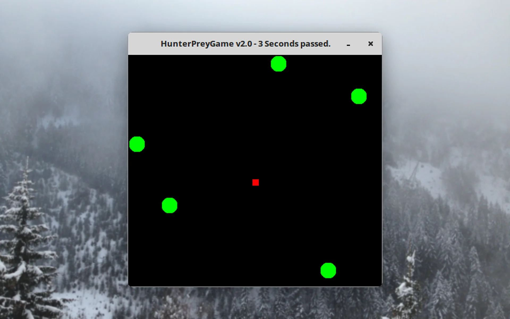
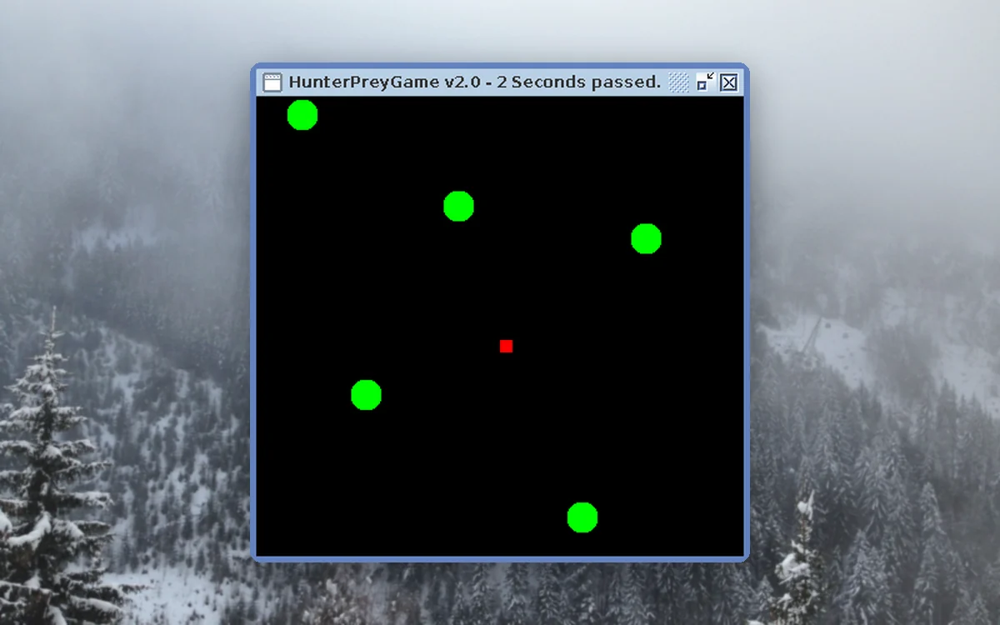
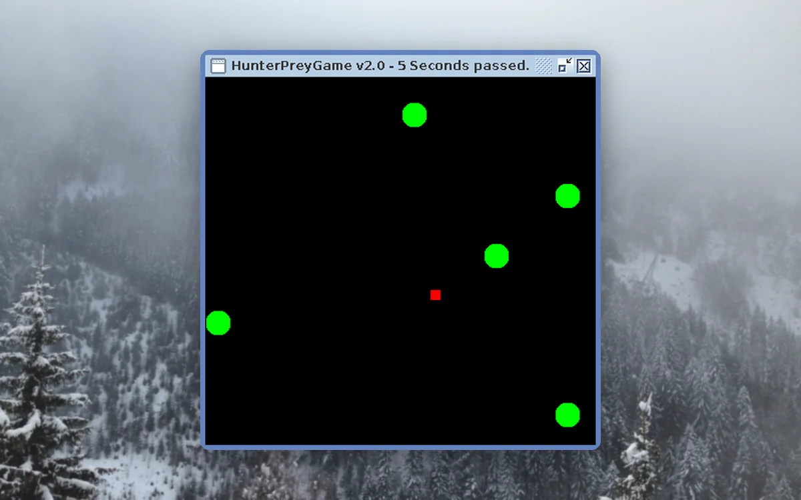
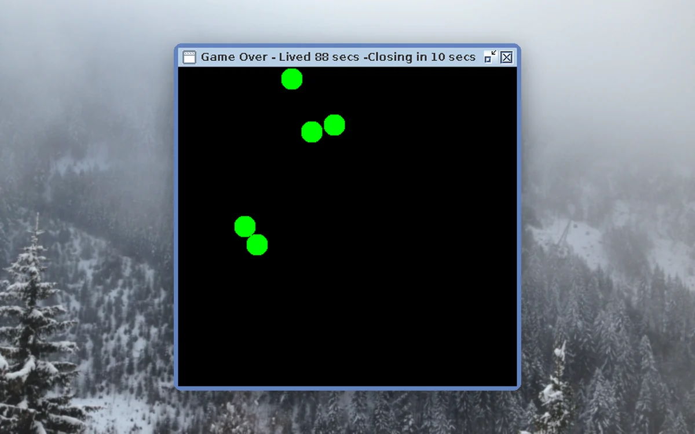
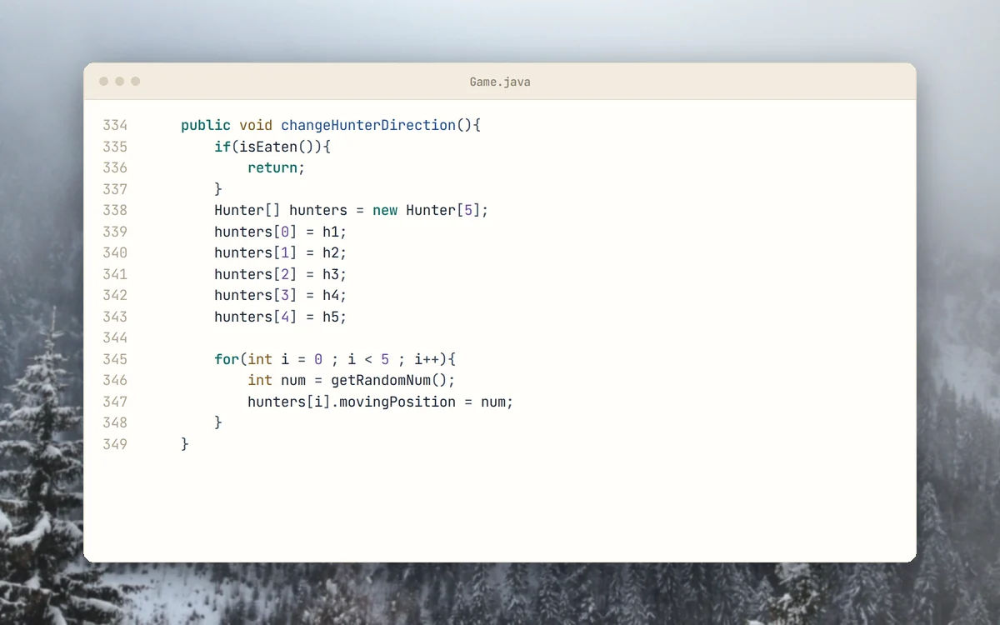

<p align="center">
  <picture>
    <source media="(prefers-color-scheme: dark)" srcset="docs/brand/svg/hunter-prey-logo-on-dark.svg">
    
  </picture>
</p>

<h1 align="center">Dodge the green circles. Count the seconds.</h1>

<p align="center">
  A first game written in 2016, archived as it was.<br>
  <b>Java Swing. Five hunters. One red square to keep alive.</b>
</p>

<p align="center">
  
  
  
  
  <a href="https://github.com/mertkayacs/HunterPreyGame"></a>
</p>

<p align="center">
  <a href="#quick-start"></a>
  <a href="src/Map.java"></a>
  <a href="https://mertkayacs.com/?utm_source=github&utm_medium=readme&utm_campaign=HunterPreyGame-repo&utm_content=portfolio-badge"></a>
</p>

<p align="center">
  <picture>
    <source media="(prefers-color-scheme: dark)" srcset="docs/assets/readme/hero-dark.webp">
    
  </picture>
</p>

Hunter Prey Game is a small survival game in Java Swing with no framework. You steer a red square while five green circles drift around the board in random directions, and the window title counts the seconds you stay alive. When a hunter touches you, the title shows how long you lived and the window closes after ten seconds. The game waits on a thread between steps and does not use intersects().

---

## Why Hunter Prey Game

The whole game is four Java files.

|  |  |
|---|---|
|  **Two ways to move** | Use W, A, S and D or the arrow keys. The key handling is in [Map.java](src/Map.java). |
|  **A live score** | The title bar shows the seconds you have survived and updates once per second. |
|  **Plain Java** | No framework and no dependencies. The Eclipse project targets Java 8. |

## A quick tour

<table>
  <tr>
    <td width="50%" valign="top">
      <picture>
        <source media="(prefers-color-scheme: dark)" srcset="docs/assets/readme/tour/start-dark.webp">
        
      </picture>
      <h3>Round start</h3>
      Five hunters drift around the board while the title bar counts seconds. The prey is the small red square.
    </td>
    <td width="50%" valign="top">
      <picture>
        <source media="(prefers-color-scheme: dark)" srcset="docs/assets/readme/tour/moved-dark.webp">
        
      </picture>
      <h3>Moving the prey</h3>
      W, A, S, D or the arrow keys move the red square.
    </td>
  </tr>
  <tr>
    <td width="50%" valign="top">
      <picture>
        <source media="(prefers-color-scheme: dark)" srcset="docs/assets/readme/tour/over-dark.webp">
        
      </picture>
      <h3>Game over</h3>
      When a hunter touches the prey, the title shows how long you lived and the window closes ten seconds later.
    </td>
    <td width="50%" valign="top">
      <picture>
        <source media="(prefers-color-scheme: dark)" srcset="docs/assets/readme/tour/code-dark.webp">
        
      </picture>
      <h3>Random hunters</h3>
      Every few steps each hunter gets a new random direction out of eight.
    </td>
  </tr>
</table>

<p align="center"><sub>Captured from the running game on a virtual display. The window frames are drawn by Swing because that display has no window manager.</sub></p>

## Features

**Gameplay**

- Five hunters move in random directions around a single prey.
- The window closes itself ten seconds after the game ends.

**Code**

- Map.java holds the window, the game loop and the keys.
- Game.java draws the board and detects when a hunter touches you.
- Hunter.java and Prey.java hold the two kinds of piece.

## Quick start

```sh
cd src
javac *.java
java Map
```

### Requirements

- A Java JDK. The Eclipse project settings use Java 8.

## FAQ

<details>
<summary><b>How do I move?</b></summary>

With W, A, S and D or the arrow keys.
</details>

<details>
<summary><b>How long does a round last?</b></summary>

Until a hunter touches you. The title bar counts the seconds, then the window closes ten seconds after the game ends.
</details>

<details>
<summary><b>Is this coursework?</b></summary>

No. It is a first personal game from 2016 that was uploaded in 2019.
</details>

If Hunter Prey Game is useful to you, a ⭐ helps other people find it.

Photos behind the screenshots are credited in [docs/assets/readme/CREDITS.md](docs/assets/readme/CREDITS.md).

[](https://github.com/mertkayacs/HunterPreyGame)
